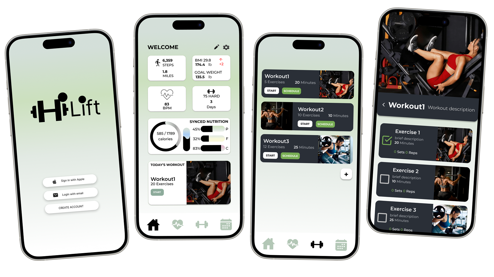
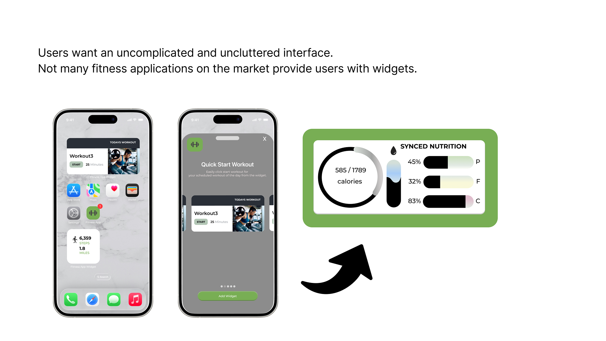
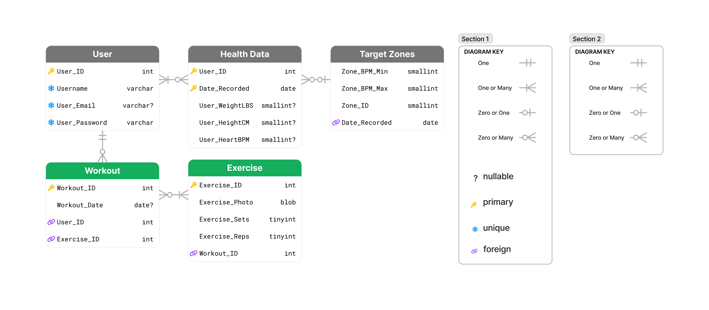

# Fitness Tracker iOS Application: hi.lift-app
<b>Final Project:</b> SE2100, Professor Alghazo | University of Minnesota, Crookston

| Collaborator | Role |
| --- | --- |
| Molly Gustafson | UI Designer, Component Designer, Software Engineer |
| Angelina Allen | UI Designer, Software Requirements |
 

## Problem & Scope

The current market of fitness applications include mobile applications that are overly complex with features. Users need a way to log and plan workouts, monitor health metrics, and track fitness goals using an interface that is uncomplicated and uncluttered. This software will address the need for a tracking method that does not sacrifice simplicity and usability for unnecessary features or application ads. Not many fitness apps on the market offer widgets; a fitness widget would give users an efficient way to track workouts and stay consistent in their goals. This application will prioritize the user, providing a platform that encourages motivation. The application is focused on the user that wants to get “locked in”.  

This project is the Mobile Fitness and Health Tracker App, Hi.lft. It will allow users to create custom workouts from pre-made exercises showing the example of how the user uses the machine or their own body, track and plan workouts with an in-app calendar, track health metrics, customize their homepage within the application with the day's plan and stats, and use widgets which allow the user to see their daily plan on their mobile homescreen. Each workout lets the user enter weight, set, reps, and time. During set up the user will be asked some initial questions to create a user profile which can be edited later. It will ask them their goal weight if applicable. It will also ask the user for their initial check in for a metrics starting point.   

The customizable homepage includes features the user chooses to see, our focus is on the user having a lot of control over their user interface. The next tab will be the user’s metrics tab that shows a graph of rep increase/set increase and a goal tracker to show the user if they reached their monthly goal. The next tab will be a calendar, where the user adds workouts day by day. The user can save, edit, and reuse the workouts they create. This calendar integrates with the widget so that the widget only shows what workouts are for the current day to provide simplicity. The application includes integration with the built in health/fitness apps on iOS. As well as integration with smart rings like Ultrahuman and Oura. The application exercise library will be maintained in a database. The database will also keep track of the users saved workout plans.   

## Core Features & Requirements

| Function Name | Description |
| --- | --- |
| Workout Creation | Create custom workouts from premade exercises, specifying reps and sets. |
| Workout Scheduling & Logging | Log and schedule workouts using in-app calendar. Users may create a new workout or select a saved workout. |
| Health Tracking | Input health metrics manually or through the integration of the health app and wearables (Ultrahuman smart ring, Oura ring, Apple Watch, etc.). |
| Metrics Summary | Allow users to view the summary of their health and workout data over time. |
| Homepage Customization | Allow users to customize their homepage using a variety of modules. |
| Widget Creation | Allow users to create widgets to add to their mobile homescreen. |
 

## Data Model 

## System Architecture & Overview

## Tech Stack

